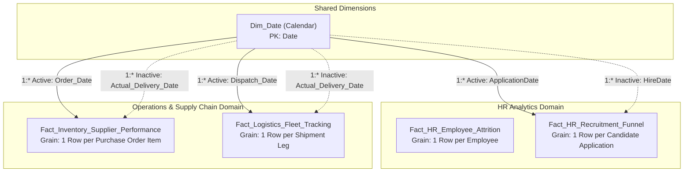
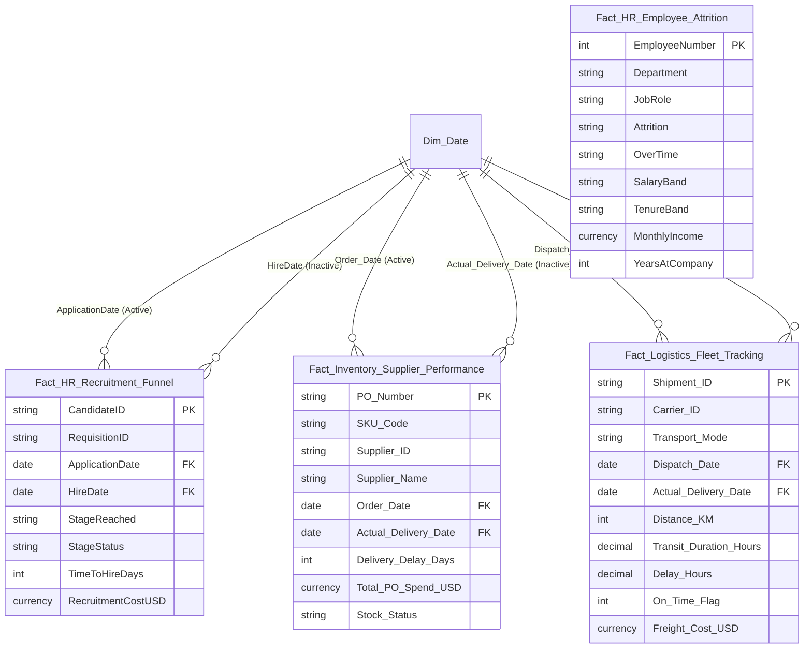

# Enterprise Data Model Architecture & Star Schema Specifications

This document defines the dimensional modeling strategy, Entity-Relationship (ER) schemas, table classifications, cardinality mappings, and relationship rules for the Power BI Multi-Domain Solution (HR Analytics & Operations/Supply Chain).

---

## 1. High-Level Architectural Overview

The architecture implements Kimball-style Dimensional Modeling tailored for the Microsoft Power BI VertiPaq tabular in-memory engine:
- **Fact Tables**: Contain granular quantitative transactional and event data (`IBM_HR_Employee_Attrition`, `HR_Recruitment_Funnel`, `Inventory_Supplier_Performance`, `Logistics_Fleet_Tracking`).
- **Shared Conformed Dimensions**: Reusable across domains (e.g., `Dim_Date`).
- **Domain Specific Dimensions**: Facilitate slice-and-dice operations with 1-to-Many (`1:*`) relationships and single-direction filtering.



---

## 2. Table Specifications & Classifications

### Domain 1: HR Analytics

#### Table 1: `Fact_HR_Employee_Attrition`
- **Grain**: One record per employee (Snapshot/Status fact table).
- **Primary Key**: `EmployeeNumber`
- **Categorical Attributes**: `Department`, `JobRole`, `BusinessTravel`, `EducationField`, `Gender`, `MaritalStatus`, `OverTime`, `SalaryBand`, `TenureBand`.
- **Numeric Measures**: `MonthlyIncome`, `TotalWorkingYears`, `YearsAtCompany`, `YearsInCurrentRole`, `YearsSinceLastPromotion`, `YearsWithCurrManager`, `Age`, `DailyRate`, `HourlyRate`, `PercentSalaryHike`.
- **Survey Scales (1-4)**: `EnvironmentSatisfaction`, `JobInvolvement`, `JobSatisfaction`, `RelationshipSatisfaction`, `WorkLifeBalance`.

#### Table 2: `Fact_HR_Recruitment_Funnel`
- **Grain**: One record per candidate job application.
- **Primary Key**: `CandidateID`
- **Foreign Keys**: `ApplicationDate` -> `Dim_Date[Date]` (Active), `HireDate` -> `Dim_Date[Date]` (Inactive).
- **Funnel Stages**: `1. Applied` -> `2. Screened` -> `3. Interviewed` -> `4. Offer Extended` -> `5. Hired`.
- **Categorical Attributes**: `Department`, `JobRole`, `ApplicationSource`, `RecruiterName`, `StageReached`, `StageStatus`, `OfferAccepted`.
- **Metrics**: `TimeToHireDays`, `TimeToOfferDays`, `RecruitmentCostUSD`, `CandidateExperienceRating`.

---

### Domain 2: Operations & Supply Chain

#### Table 3: `Fact_Inventory_Supplier_Performance`
- **Grain**: One record per Purchase Order line item / SKU delivery.
- **Primary Key**: `PO_Number`
- **Foreign Keys**: `Order_Date` -> `Dim_Date[Date]` (Active), `Actual_Delivery_Date` -> `Dim_Date[Date]` (Inactive).
- **Dimensions / Identifiers**: `SKU_Code`, `Product_Category`, `Supplier_ID`, `Supplier_Name`, `Warehouse_Location`, `Delivery_Status`, `Stock_Status`.
- **Key Metrics**: `Order_Quantity`, `Received_Quantity`, `Defect_Quantity`, `Unit_Cost_USD`, `Total_PO_Spend_USD`, `Delivery_Delay_Days`, `Current_Stock_Level`, `Safety_Stock_Level`, `Reorder_Point`, `Annual_Carrying_Cost_USD`, `Inventory_Turnover_Ratio`.

#### Table 4: `Fact_Logistics_Fleet_Tracking`
- **Grain**: One record per shipment transport event.
- **Primary Key**: `Shipment_ID`
- **Foreign Keys**: `Dispatch_Date` -> `Dim_Date[Date]` (Active), `Actual_Delivery_Date` -> `Dim_Date[Date]` (Inactive).
- **Dimensions / Identifiers**: `Carrier_ID`, `Carrier_Name`, `Transport_Mode`, `Origin_City`, `Destination_City`, `Route_Lane`, `Delivery_Status`, `Delay_Reason`.
- **Key Metrics**: `Distance_KM`, `Transit_Duration_Hours`, `Delay_Hours`, `On_Time_Flag`, `Route_Efficiency_Index_Pct`, `Fuel_Consumption_Liters`, `CO2_Emissions_KG`, `Freight_Cost_USD`, `Cost_Per_KM_USD`, `Customer_Satisfaction_Score`.

---

## 3. Entity-Relationship (ER) Schema



---

## 4. Modeling Best Practices & Performance Optimization Rules

1. **Strict 1-to-Many (`1:*`) Relationships**:
   - Ensure all dimension keys in `Dim_Date` are distinct (no duplicate dates).
   - Never use Many-to-Many (`*:*`) relationships between fact and dimension tables.
2. **Single Cross-Filter Direction**:
   - Filter propagation strictly runs from Dimension -> Fact (downwards).
   - Avoid bi-directional cross-filtering (`Both`) as it causes query ambiguity, circular paths, and significant VertiPaq engine slowdowns.
3. **Role-Playing Date Relationships**:
   - For secondary dates (e.g. `HireDate`, `Actual_Delivery_Date`), the relationship is marked **Inactive**.
   - Activate them inside specific DAX measures using `USERELATIONSHIP()`, e.g.:
     ```dax
     Hires in Period = 
     CALCULATE(
         [Total Hired],
         USERELATIONSHIP('Fact_HR_Recruitment_Funnel'[HireDate], 'Dim_Date'[Date])
     )
     ```
4. **Sort By Column Configuration**:
   - `SalaryBand` -> Sort by `SalaryBandSort`
   - `TenureBand` -> Sort by `TenureBandSort`
   - `StageReached` -> Sort by `StageSortIndex`
   - `Month Name` -> Sort by `Month Number`
   - `Year-Month` -> Sort by `YearMonthKey`
5. **VertiPaq Memory Optimization**:
   - Avoid high-cardinality floating point values where integers or fixed decimals suffice.
   - Separate Date and Time components into distinct columns rather than storing datetime timestamps with microsecond precision.

