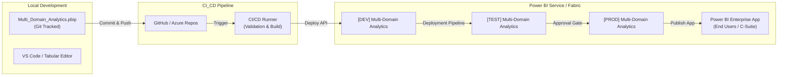

# Power BI Enterprise Deployment & Lifecycle Management Guide

This document provides end-to-end instructions for deploying the **Multi-Domain Analytics Suite (HR & Supply Chain)** to the **Microsoft Power BI Service (Cloud) / Microsoft Fabric**.

---

## 1. Enterprise Deployment Architecture



---

## 2. Workspace Setup & Environment Separation

Create three dedicated workspaces in Power BI Service to isolate development from production:

| Environment | Workspace Name | Purpose | Recommended License |
| :--- | :--- | :--- | :--- |
| **Development** | `[DEV] Multi-Domain Analytics` | Active model development, M query testing, DAX authoring | Pro or Fabric Capacity |
| **Testing / UAT** | `[TEST] Multi-Domain Analytics` | Business user acceptance, data validation, RLS testing | Pro or Fabric Capacity |
| **Production** | `[PROD] Multi-Domain Analytics` | Official executive dashboards, scheduled refreshes, App distribution | Premium / Fabric F64+ or PPU |

---

## 3. Deployment Method A: Automated Deployment via PowerShell

We have provided a production-ready deployment automation script:
`09_Deployment/Deploy_To_PowerBI_Service.ps1`

### Prerequisites:
1. An Azure AD / Entra ID **Service Principal** with Power BI Tenant Read/Write permissions, or an authorized Power BI Admin account.
2. Install the official Power BI Management PowerShell modules:
   ```powershell
   Install-Module -Name MicrosoftPowerBIMgmt -Scope CurrentUser -Force
   ```

### Command Execution:
```powershell
# Interactive Admin Deployment:
.\09_Deployment\Deploy_To_PowerBI_Service.ps1 -Environment "DEV" -AuthMode "Interactive"

# Unattended CI/CD Deployment (Service Principal):
.\09_Deployment\Deploy_To_PowerBI_Service.ps1 `
    -Environment "PROD" `
    -AuthMode "ServicePrincipal" `
    -TenantId "your-entra-tenant-id" `
    -ClientId "your-app-registration-client-id" `
    -ClientSecret "your-client-secret"
```

The script automatically:
1. Validates or creates the target workspace.
2. Publishes `Multi_Domain_Analytics.pbip` / `.pbix`.
3. Binds the dataset to the on-premises or VNet Gateway.
4. Configures scheduled refresh intervals (e.g., daily at 06:00 and 13:00 UTC).
5. Configures failure alert email notifications to stakeholders.

---

## 4. Deployment Method B: Manual Desktop Publishing

For immediate ad-hoc publishing directly from Power BI Desktop:

1. Double-click [Multi_Domain_Analytics.pbip](file:///c:/Users/rajuv/OneDrive/Desktop/POWER%20BI/Multi_Domain_Analytics.pbip) to open the project in Power BI Desktop.
2. Verify all visuals, DAX measures, and relationships load properly.
3. Click the **Publish** button located on the **Home** ribbon (top-right).
4. Select the destination workspace (e.g., `[DEV] Multi-Domain Analytics` or `My Workspace`).
5. Wait for the upload confirmation dialog: *"Success: Your report is now available in Power BI Service"*.
6. Click the generated link to view your live report in the browser.

---

## 5. Gateway Configuration & Automated Scheduled Refresh

Because the datasets currently connect to local file paths, scheduled cloud refreshes require a **Power BI On-Premises Data Gateway** or migration to cloud storage (**Azure Data Lake Storage Gen2 / OneDrive / SharePoint**).

### Option 1: On-Premises Data Gateway (Enterprise Mode)
1. Download and install the **On-premises Data Gateway** on the host server/machine.
2. Open **Power BI Service** $\rightarrow$ **Settings (Gear Icon)** $\rightarrow$ **Manage connections and gateways**.
3. Under **Connections**, click **+ New**:
   - Connection Type: `File` or `Folder`
   - Path: `c:\Users\rajuv\OneDrive\Desktop\POWER BI\01_Data\`
   - Authentication Method: `Windows` (Enter Windows domain/user and credentials).
4. Navigate to your dataset settings in the workspace $\rightarrow$ **Gateway connection** $\rightarrow$ Map the source to your gateway connection.

### Option 2: Cloud Storage Native Refresh (Recommended for Production)
1. Move the `01_Data` folder to a corporate **SharePoint Document Library** or **Azure Data Lake Gen2**.
2. In Power BI Desktop, edit the Power Query M scripts to use `SharePoint.Files()` or `AzureStorage.DataLake()` instead of `File.Contents()`.
3. Scheduled refresh will now execute purely in the cloud without requiring a local gateway.

### Scheduled Refresh Cadence:
- **HR Datasets**: Daily at 01:00 AM (Reflects daily HRIS sync).
- **Inventory & Logistics**: Every 4 hours or hourly (06:00, 10:00, 14:00, 18:00 UTC) for real-time tracking.

---

## 6. Row-Level Security (RLS) Configuration

Security roles are defined in `09_Deployment/Row_Level_Security_Roles.dax`:
1. **`HR_Department_Head`**: Dynamically restricts attrition and recruitment data to the manager's assigned department.
2. **`HR_Talent_Acquisition_Team`**: Grants access to all recruitment pipeline metrics while obfuscating salary bands.
3. **`SC_Regional_Warehouse_Manager`**: Restricts inventory stock and supplier delays to the user's specific warehouse (`WH-North`, `WH-South`, etc.).
4. **`SC_Carrier_Partner`**: Restricts logistics fleet tracking to shipments belonging to that specific carrier ID.

### Assigning Users in Power BI Service:
1. In the target workspace, go to the dataset $\rightarrow$ click the **`...`** (More options) $\rightarrow$ **Security**.
2. Select a role (e.g., `SC_Regional_Warehouse_Manager`).
3. Enter the email addresses or **Microsoft Entra ID Security Groups** (e.g., `SG_Warehouse_Ops_Managers`).
4. Click **Save**.
5. Use the **Test as role** feature to verify that the filters apply as expected.

---

## 7. Power BI App Packaging & Audience Distribution

Rather than giving business users direct access to workspace items, package the report into a **Power BI App**:

1. In the `[PROD]` workspace, click **Create app** (top-right ribbon).
2. **Setup Tab**:
   - App Name: `Multi-Domain Operations & Talent Intelligence`
   - Description: `Official executive dashboard suite for HR workforce metrics, recruitment velocity, supply chain inventory, and logistics fleet performance.`
   - Logo & Theme Color: Primary Navy `#0F172A` / Accent Blue `#2563EB`.
3. **Navigation Tab**:
   - Organize into two custom collapsible sections:
     - 📁 **Human Resources**:
       - 📄 Employee Attrition Diagnostics
       - 📄 Recruitment Funnel & Velocity
     - 📁 **Supply Chain & Logistics**:
       - 📄 Inventory & Supplier Performance
       - 📄 Logistics & Fleet Tracking
4. **Audience Tab**:
   - **Audience 1 (Executive Leadership)**: All 4 pages visible.
   - **Audience 2 (HR Management)**: Only HR pages visible.
   - **Audience 3 (Supply Chain & Fleet)**: Only Operations pages visible.
5. Click **Publish app** and share the App URL with corporate stakeholders.

